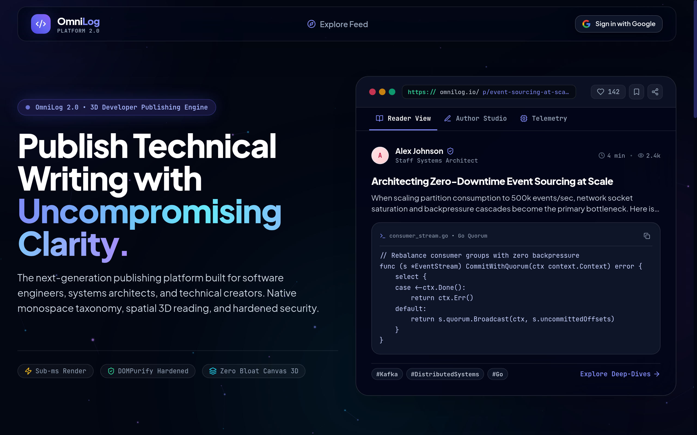

# OmniLog 🚀

> **OmniLog** is a modern, high-performance publishing platform for technical dev logs, coding tutorials, architecture deep-dives, personal essays, and journals.

Built with **React.js** (pure JavaScript with Vite & Tailwind CSS) and **Node.js** (pure JavaScript with Express & Mongoose 8), designed for seamless deployment on **Vercel** and **Render**.

---

<p align="center">
  
</p>

---

## ✨ Key Platform Features

- **Interactive 3D Spatial Canvas & Parallax**: Hardware-accelerated CSS 3D tilt cards (`Card3D.jsx`), GPU-composited velocity planes (`ParallaxLayer.jsx`), and native HTML5 Canvas 2D constellation background with cursor gravity field.
- **Hero Showcase (`HeroShowcase.jsx`)**: Multi-tab interactive hero featuring live article reading simulation with scroll progress, author studio with simulated live typing, and real-time platform engine telemetry.
- **Dual-Mode Explore Feed (`/feed`)**: Seamlessly switch between continuous `IntersectionObserver` Infinite Stream and responsive paginated feed with instant scroll-to-top.
- **Unified Data Table Pagination (`DataTablePagination.jsx`)**: Glassmorphism pagination controls with live range indicators (`Showing X to Y of Z entries`) across Author and Super Admin consoles.
- **Modular Syntax Highlighting Engine**: 90.8% bundle reduction (87.5 kB vs 950 kB) loading 16 essential languages through `utils/highlight.js`.
- **Full-Stack Performance Engineering**: Gzip/Deflate API response compression (1KB+ threshold), in-memory 60-second TTL popular tag caching with HTTP `Cache-Control`, lean MongoDB queries (`.lean()`, `.select('-body -__v')`), and compound indexes.
- **Enterprise-Grade Security**: Stateless JWT via `HttpOnly` Secure cookies, Google OAuth 2.0 Single Sign-On, DOMPurify HTML sanitization, and Helmet HTTP security headers.

---

## 📚 Living Project Documentation

The project includes a comprehensive, living documentation suite in the [`/docs`](./docs) directory:

| Document | Description |
| :--- | :--- |
| **[Project Overview (`docs/PROJECT.md`)](./docs/PROJECT.md)** | Mission, user personas, core domain models (`Post` and `User`), feature matrix, and completed milestones. |
| **[Architecture Guide (`docs/ARCHITECTURE.md`)](./docs/ARCHITECTURE.md)** | System diagrams, stateless JWT auth lifecycle, modular syntax highlighting, performance pipelines, and REST API specification. |
| **[Developer Guide (`docs/DEVELOPMENT.md`)](./docs/DEVELOPMENT.md)** | Prerequisites, local setup, monorepo scripts, and JavaScript coding conventions (highlight imports, lean queries). |
| **[UI/UX Design System (`docs/DESIGN.md`)](./docs/DESIGN.md)** | Color palette, typography scale, component specs (HeroShowcase, DataTablePagination), and WCAG 2.1 AA accessibility standards. |
| **[Testing & QA (`docs/TESTING.md`)](./docs/TESTING.md)** | Testing pyramid, Supertest API integration suites (53 tests across 6 suites), and running tests. |
| **[Deployment Guide (`docs/DEPLOYMENT.md`)](./docs/DEPLOYMENT.md)** | Step-by-step production setup for **Vercel** and **Render** (`render.yaml`), plus OAuth configuration. |
| **[Bug Tracker & Security (`docs/BUGS.md`)](./docs/BUGS.md)** | Triage register of legacy issues (XSS, secrets, deprecated methods), resolved bugs (BUG-001 through BUG-013), and bug reporting templates. |
| **[AI Agent Operating Manual (`docs/AGENT_GUIDELINES.md`)](./docs/AGENT_GUIDELINES.md)** | Guidelines, repository landmarks, and verification checklists for future AI coding agents. |

---

## ⚡ Quick Start

### 1. Prerequisites
- **Node.js**: `v18.0.0` or higher
- **npm**: `v9.0.0` or higher
- **MongoDB**: Local MongoDB or MongoDB Atlas URI

### 2. Install Dependencies
```bash
# Installs root, client, and server dependencies
npm install
```

### 3. Configure Environment Variables
```bash
# Server environment
cp server/.env.example server/.env

# Client environment
cp client/.env.example client/.env
```

> **Contact Form & Resend API**:
> - `RESEND_API_KEY`: API key from [resend.com](https://resend.com) (leave as placeholder for dev simulation mode).
> - `CONTACT_EMAIL_TO`: Destination mailbox where customer inquiries are routed.
> - `CONTACT_EMAIL_FROM`: Sender identity (e.g. `OmniLog Contact <onboarding@resend.dev>`).


### 4. Start Development Server
```bash
# Runs backend on http://localhost:5000 and frontend on http://localhost:5173
npm run dev
```

---

## 🛠️ Monorepo Scripts Reference

- `npm run dev`: Concurrently start both backend API and frontend Vite client.
- `npm run dev:server`: Start backend API only (with nodemon).
- `npm run dev:client`: Start frontend React client only (with Vite).
- `npm run build`: Build production frontend assets.
- `npm test`: Run backend API integration test suites (Supertest + Jest).

---

## 🚢 Deployment Ready

- **Render**: Uses the included [`render.yaml`](./render.yaml) blueprint to deploy both the API Web Service and the Client Static Site with 1 click.
- **Vercel**: Uses [`vercel.json`](./vercel.json) for automatic SPA routing to `index.html`.

---

## 📄 License
ISC License — Created by Amit Bora
